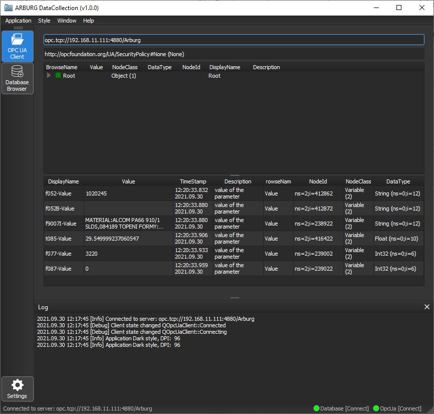
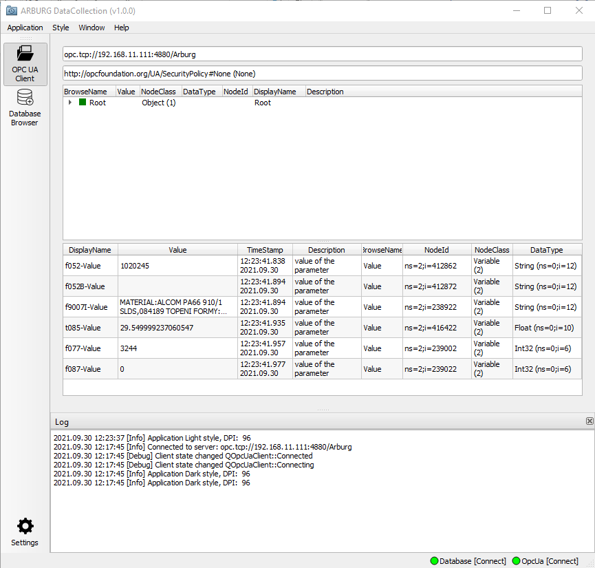
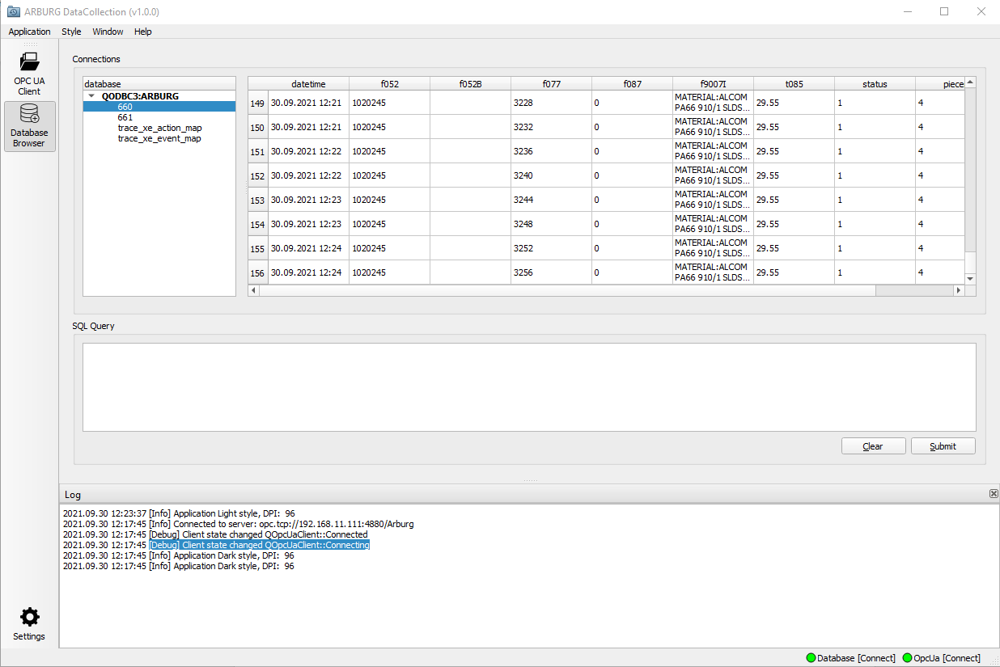
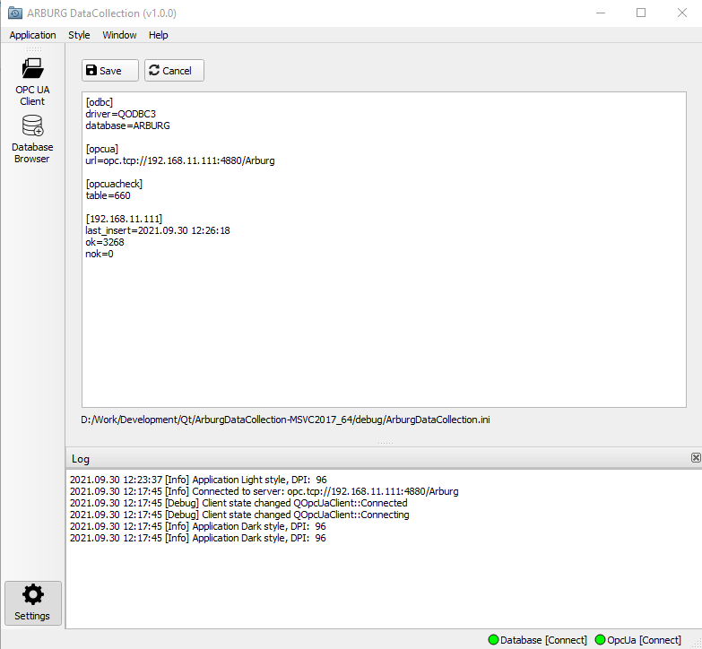

# Přehled projektu

`ArburgDataCollection` je desktopová aplikace v C++ a Qt, která propojuje výrobní data stroje Arburg s SQL databází. Připojuje se k OPC UA serveru, umožňuje procházet jeho adresní prostor a pravidelně čte vybrané hodnoty. Při změně výrobních počítadel z nich vytváří záznamy o vyrobených dobrých a neshodných kusech.

Aplikace používá Qt Widgets pro uživatelské rozhraní, Qt OPC UA pro komunikaci se strojem a Qt SQL pro databázové připojení. Jednotlivé části lze využít takto:

- **OPC UA pohled** zobrazuje uzly a aktuální hodnoty a řídí připojení i opětovné připojení k serveru.
- **Zpracování výroby** vybírá potřebné hodnoty ze čtených proměnných a ukládá výrobní záznamy.
- **SQL prohlížeč** umožňuje spravovat databázové připojení a spouštět dotazy.
- **Nastavení a logování** uchovávají stav aplikace a poskytují diagnostické zprávy.

# Sběr dat přes OPC UA

Komunikaci se serverem zajišťuje `opcua/OpcUaView.*`. Aplikace načítá dostupné OPC UA backendy, zjišťuje servery a koncové body a po připojení zpřístupňuje adresní prostor v přehledném stromu a tabulce. Vybrané hodnoty se čtou periodicky. Stav spojení je zobrazen v aplikaci a při výpadku se spustí opakované připojování.

Pro výrobní záznamy se používají tyto položky:

| Proměnná | Význam |
|---|---|
| `f052` | označení položky |
| `f052B` | popis položky |
| `f077` | kumulativní počet dobrých kusů |
| `f087` | kumulativní počet neshodných kusů |
| `f9007I` | doplňující informace o zakázce |
| `t085` | doba cyklu |

# Převod počítadel na výrobní záznamy

Třída `OpcUaCheck` spojuje načtené hodnoty do jednoho výrobního záznamu. Porovnává aktuální počty dobrých a neshodných kusů s posledním uloženým stavem a vypočítá jejich přírůstek. Každý kladný přírůstek zapíše do nakonfigurované SQL tabulky jako počet kusů spolu s časem, informacemi o položce, zakázce a době cyklu. Záznam obsahuje také stav rozlišující dobré a neshodné kusy.

Pokud se kumulativní počítadlo po resetu sníží, aplikace začne počítat od nové hodnoty místo toho, aby vytvořila záporný rozdíl. Poslední známý čas a hodnoty počítadel se ukládají v nastavení aplikace, aby šlo při dalším spuštění navázat na předchozí stav.

# Databázový prohlížeč a konfigurace

Část `browser/` poskytuje správu SQL připojení a jednoduchý prohlížeč dotazů. Databáze využívá Qt SQL, takže konkrétní ovladač a parametry připojení se vybírají podle cílové instalace. Aplikace před spuštěním potřebuje nakonfigurovat vlastní OPC UA endpoint, příslušné uzly a připojení k databázi.

Projektový soubor `ArburgDataCollection.pro` deklaruje Qt Core, Gui, Widgets, SQL a OPC UA. Projekt lze otevřít v Qt Creator s instalací Qt, která tyto moduly obsahuje.

# Uživatelské rozhraní

Uživatelský manuál popisuje tři hlavní pohledy: OPC UA Client, Database Browser a Settings. V pohledu OPC UA Client lze vybrat backend, server a koncový bod, procházet strom uzlů a sledovat zvolené hodnoty. Tabulka sledovaných hodnot zobrazuje název, hodnotu, čas posledního čtení, popis, BrowseName, NodeId, třídu uzlu a datový typ. Stavové řádky ukazují připojení k OPC UA a databázi; samostatný panel zobrazuje aplikační log.

Database Browser nabízí seznam připojení a tabulek, výslednou datovou tabulku a editor SQL dotazů s akcemi pro vymazání a spuštění dotazu. Pohled Settings umožňuje upravit nastavení databázového a OPC UA připojení i cílovou tabulku. Manuál také ukazuje světlý a tmavý styl aplikace.

Následující snímky pocházejí z uživatelského manuálu.

# Struktura projektu

- `opcua/` obsahuje OPC UA klienta, prohlížení uzlů a zpracování výrobních hodnot.
- `browser/` obsahuje SQL prohlížeč a správu připojení.
- `settings/` uchovává aplikační nastavení a poslední hodnoty počítadel.
- `log/` zajišťuje aplikační logování.
- `support/` a `resources/` obsahují pomocné prvky uživatelského rozhraní a vzhledu.

Zdrojový kód: [CodElecCz/arburg-data-collection](https://github.com/CodElecCz/arburg-data-collection).