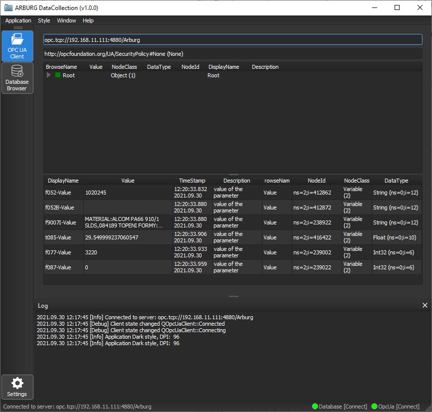
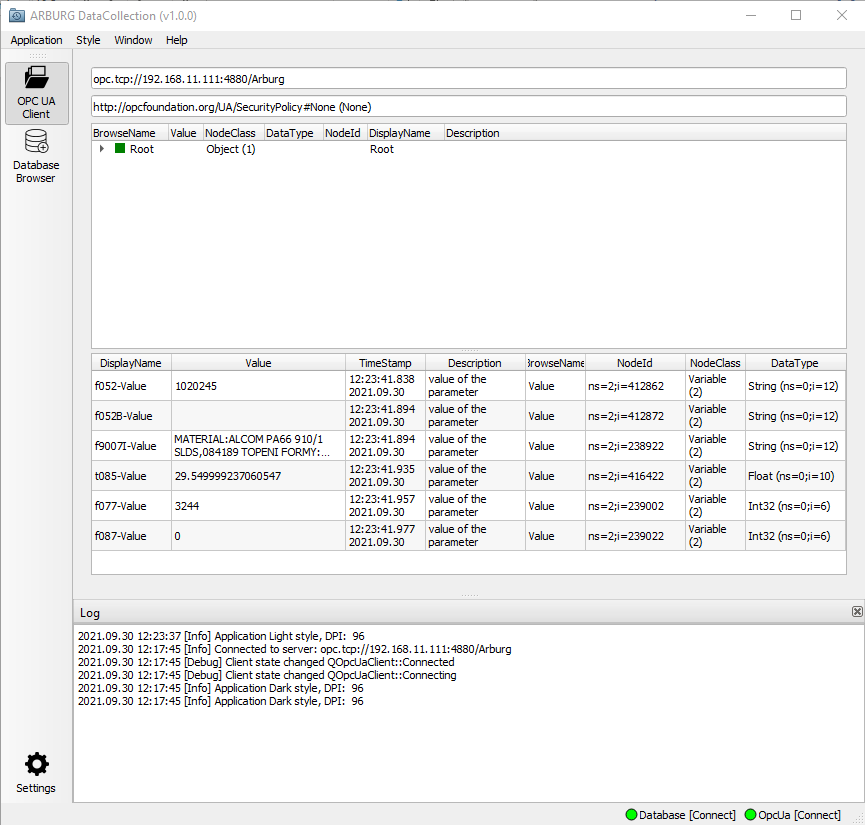
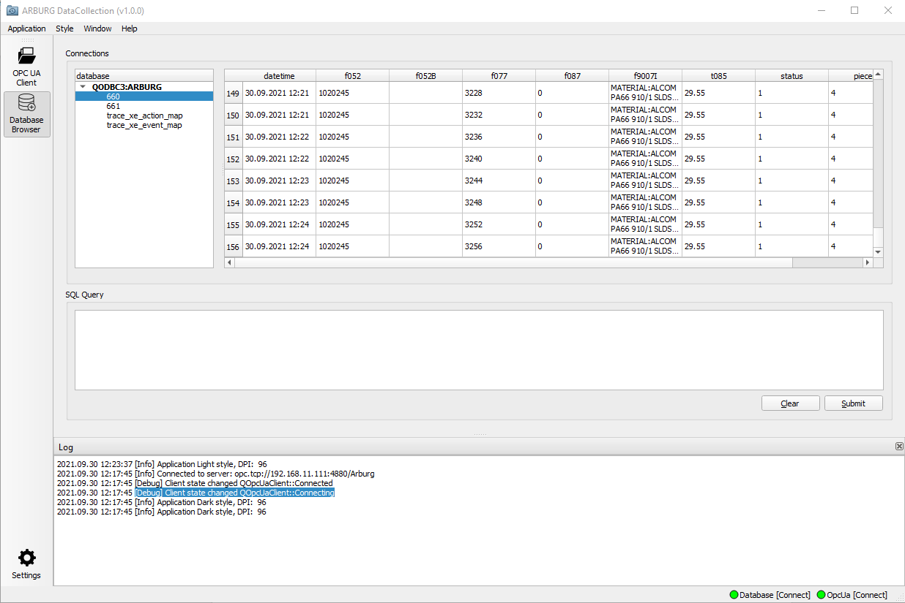

# Project overview

`ArburgDataCollection` is a C++ and Qt desktop application that connects Arburg machine data to a SQL database. It connects to an OPC UA server, lets an operator browse its address space, and periodically reads selected values. Changes in the production counters are converted into records for good and rejected pieces.

The application uses Qt Widgets for its user interface, Qt OPC UA for machine communication, and Qt SQL for database access. Its main components are:

- **OPC UA view** displays nodes and current values and manages server connection and reconnection.
- **Production processing** selects the required values from each read and stores production records.
- **SQL browser** manages database connections and runs queries.
- **Settings and logging** retain application state and provide diagnostic messages.

# Reading data over OPC UA

`opcua/OpcUaView.*` handles communication with the server. The application loads available OPC UA backends, discovers servers and endpoints, and after connecting makes the address space available in a tree and table view. Selected values are read periodically. Connection status is shown in the application, and a reconnect timer is started when the connection is lost.

The production records use the following values:

| Variable | Meaning |
|---|---|
| `f052` | item identifier |
| `f052B` | item description |
| `f077` | cumulative good-piece count |
| `f087` | cumulative rejected-piece count |
| `f9007I` | additional job information |
| `t085` | cycle time |

# Turning counters into production records

`OpcUaCheck` combines the values into a production record. It compares the current good and rejected counts with the last stored values and calculates each increase. Every positive increase is inserted into the configured SQL table with a timestamp, item and job information, and cycle time. The record also includes a status distinguishing good pieces from rejects.

If a cumulative counter decreases after a reset, the application treats the new value as the counter baseline rather than calculating a negative delta. The last known time and counter values are stored in application settings so the next run can continue from the saved state.

# SQL browser and configuration

The `browser/` component provides SQL connection management and a query browser. Database access uses Qt SQL, so the driver and connection parameters can be selected for the target installation. Before running the application, configure the appropriate OPC UA endpoint and nodes, along with the database connection.

`ArburgDataCollection.pro` declares the Qt Core, Gui, Widgets, SQL, and OPC UA modules. Open the project in Qt Creator with a Qt installation that includes these modules.

# User interface

The user manual describes three main views: OPC UA Client, Database Browser, and Settings. In the OPC UA Client view, an operator can select a backend, server, and endpoint, browse the node tree, and monitor selected values. The monitored-values table shows each display name, value, last-read timestamp, description, BrowseName, NodeId, node class, and data type. Status indicators show OPC UA and database connection states, and a separate panel displays the application log.

Database Browser presents database connections and tables, a results grid, and an SQL editor with clear and submit actions. Settings allows the database and OPC UA connection settings and destination table to be configured. The manual also shows the application in both dark and light styles.

The screenshots below come from the user manual.

# Project structure

- `opcua/` contains the OPC UA client, address-space browser, and production-value processing.
- `browser/` contains the SQL browser and connection management.
- `settings/` stores application settings and the last counter values.
- `log/` provides application logging.
- `support/` and `resources/` contain UI helpers and styling resources.

Source code: [CodElecCz/arburg-data-collection](https://github.com/CodElecCz/arburg-data-collection).